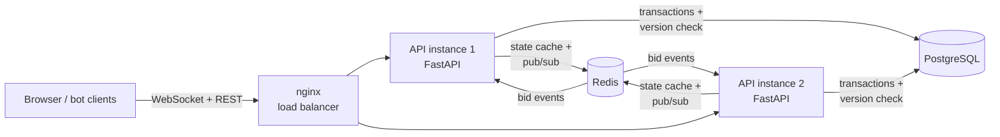

# Real-Time Auction Platform

A WebSocket auction engine with three auction formats, optimistic locking for concurrent bids, and Redis pub/sub so updates reach every client on every API instance.


## Architecture



A bid is written to Postgres inside a transaction. The row update only succeeds if the auction's `version` column hasn't changed since it was read, so concurrent bids can never overwrite each other. The accepted state is then cached in Redis and published on a channel. Every API instance subscribes to that channel and pushes the update to its own WebSocket clients, so a bid placed on instance 1 reaches clients connected to instance 2.

## Auction workflows

| Format | Rules | Code |
|---|---|---|
| English | Ascending bids with a minimum increment. A bid in the final window extends the end time (anti-sniping). | [app/workflows.py](app/workflows.py) `english_decide` |
| Dutch | The price drops on a clock down to a floor. The first buyer to accept wins at the clock price. | `dutch_decide`, `dutch_price_at` |
| Sealed-bid (Vickrey) | Bids are hidden until close. The highest bidder wins and pays the second-highest bid (or the reserve). | `sealed_decide`, `settle_sealed` |

## How concurrency is handled

- **Optimistic locking:** `UPDATE auctions SET ..., version = version + 1 WHERE id = :id AND version = :read_version`. If 0 rows change, someone else won the race, and the transaction retries with jittered backoff ([app/service.py](app/service.py) `_apply`, `_transact`).
- **Idempotent bids:** a client-supplied key is stored with the bid, so a retried request is applied once.
- **Sealed bids:** one bid per bidder, enforced in the same transaction.

## Tests

`pytest` runs 22 tests: rules for each workflow, the API and WebSocket fan-out through Redis, and concurrency tests that fire 100 simultaneous bids and assert:

- exactly one winner per price level and no lost updates (English)
- exactly one winner when 100 buyers accept the same Dutch price
- 100 identical bids produce exactly one accepted bid
- every concurrent sealed bid is recorded

CI runs the tests against real PostgreSQL 16 and Redis 7 service containers. It then starts two API instances and runs [scripts/simulate_bids.py](scripts/simulate_bids.py), which sends 1,000+ bids over WebSockets through both instances. The script reports throughput, p50/p95 latency, whether every client converged to the same final state, and whether the price history is monotonic. Results are uploaded as a CI artifact.

### Load test results (CI run [39266877367](https://github.com/Worldisbinary/realtime-auction-platform/actions/runs/39266877367), GitHub-hosted runner)

| Metric | Result |
|---|---|
| Bid events | 1,200 from 50 WebSocket clients across 2 API instances |
| Outcomes | 91 accepted, 1,093 rejected as too low, 16 rejected as already leading |
| Throughput | 215 bids/s (5.58 s total) |
| Latency | p50 82.6 ms, p95 281.9 ms |
| Clients converged to the same final state | 50 / 50 |
| Both instances agree | yes |
| Persisted bids = accepted bids | yes (no lost updates) |
| Price history strictly increasing | yes |
| Optimistic-lock conflicts resolved by retry | 696 |

Most bids are rejected on purpose: 50 clients race to outbid each other, so most bids arrive after the price has already moved past them.

## Run it

```bash
python -m venv .venv && . .venv/bin/activate      # Windows: .venv\Scripts\activate
pip install -e ".[dev]"
pytest                                            # SQLite + fakeredis, no services needed

docker compose up --build                         # 2 API instances + Postgres + Redis + nginx
open http://localhost:8080                        # demo client
python scripts/simulate_bids.py --urls http://localhost:8080
```

## Stack

FastAPI, WebSockets, SQLAlchemy 2, PostgreSQL, Redis (cache + pub/sub), Docker (multi-stage, non-root), docker compose, nginx, GitHub Actions, pytest, ruff.

## Limitations

- No user accounts or payments. Bidders are identified by a name string.
- Auction closing is triggered by an API call rather than a background scheduler.
- Load numbers come from CI runners, not production hardware.

## License

MIT
